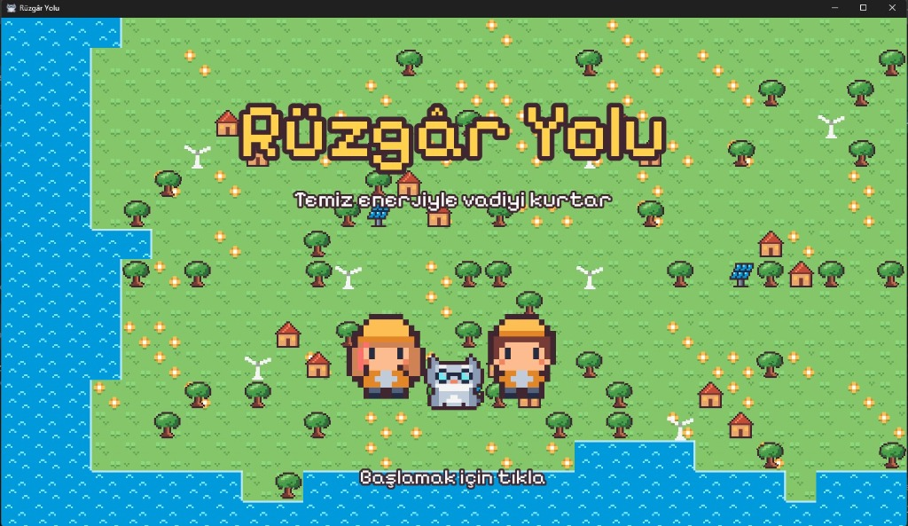
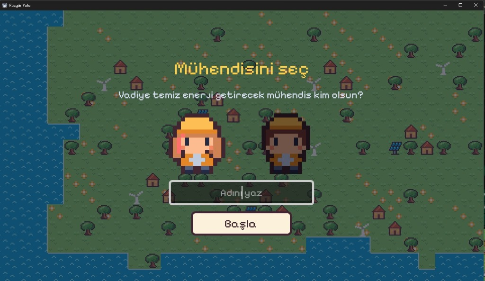
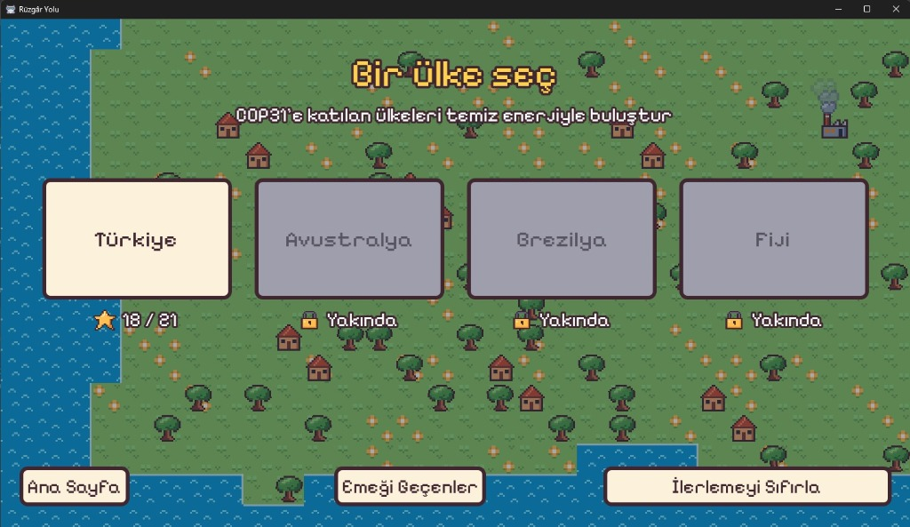
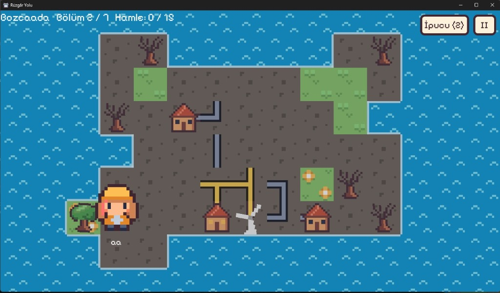
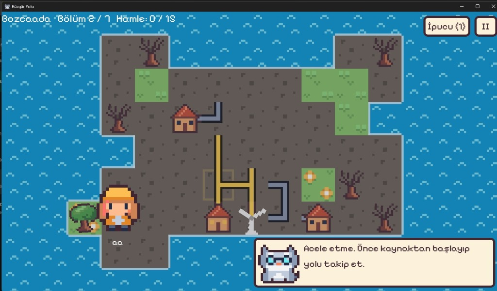

# Rüzgâr Yolu

**Kabloları çevir, Türkiye'nin kasabalarını rüzgâr ve güneşle aydınlat, kurumuş vadiyi yeniden canlandır.**

Rüzgâr Yolu, GameUP Türkiye Oyun Hackathonu için COP31 iklim teması kapsamında geliştirilen 2D pixel art bir enerji bulmacasıdır.

**[Oyunu indir (Windows)](../../releases/latest)** · **[Oynanış videosu](https://drive.google.com/file/d/1DHG27OKIUNqbpFREqgQAVIzSvm7U2MJj/view?usp=drive_link)**

## Hikâye

Bir zamanlar yemyeşil olan vadide kömür dumanı gökyüzünü kararttı. Topraklar kurudu, ağaçlar yapraklarını döktü, köylerin ışıkları söndü.

Oyuncu, kendi adını verdiği genç bir enerji mühendisi. Yanında ona ipucu veren bilge bir kedi var. Amacı, Çeşme'den Antalya'ya 7 gerçek durakta rüzgâr ve güneş enerjisini evlere ulaştırmak, kasabaları kömürden kurtarmak ve vadiyi yeniden yeşertmek.

| Karakter seçimi | Ülke seçimi |
|---|---|
|  |  |

## Nasıl oynanır

- Kablolara **tıklayarak** 90 derece çevir.
- Rüzgâr türbinlerinden ve güneş panellerinden çıkan enerjiyi **bütün evlere** ulaştır. Enerji alan kablolar sarıya döner, evlerin pencereleri yanar.
- **Kömür santrallerine dikkat:** Kömüre bağlı bir ev varken bölüm bitmez. Evleri kömürden koparmalısın.
- Üstteki **"Hamle: 5 / 18"** yazısındaki ikinci sayı 3 yıldız sınırıdır. Ne kadar az hamle, o kadar çok yıldız.
- Takılırsan **İpucu** butonuna bas ya da bilge kedinin teklifini kabul et. Her bölümde 2 ipucu hakkın var, ilki bedava.
- **Esc** ya da **II** butonu oyunu duraklatır: bölümü baştan başlatma, bölüm seçimi, ana sayfa ve müzik açma/kapama.

## Öne çıkanlar

- **İyileşen dünya:** Temiz enerjiyle yanan her evle toprak yeşerir, kuru ağaçlar canlanır, gri pus kalkar. Kömür santralini kapatınca duman kesilir.
- **Her oyunda yeni bulmaca:** Bölümler her açılışta yeniden üretilir ve her zaman çözülebilir.
- **Gerçek yerler, gerçek bilgiler:** Her bölüm Türkiye'deki gerçek bir yerde geçer, bölüm sonunda o yerin enerjisiyle ilgili bir bilgi kartı gösterilir.
- **Kendi mühendisin:** Kız ya da erkek mühendis seç, adını yaz, hikâyede senin adınla anıl.
- **Bilge kedi:** Zorlandığında zıplayarak gelip yardım teklif eder.
- **İlerleme kaydı:** Yıldızlar kaydedilir, bölümler sırayla açılır.

| Bölüm görünümü | Bilge kedinin ipucu teklifi |
|---|---|
|  |  |

## Bölümler

| # | Yer | Enerji | Bölüm sonu bilgisi |
|---|---|---|---|
| – | Öğretici | Rüzgâr | Kabloları çevirmeyi öğrenme |
| 1 | Çeşme | Rüzgâr | Türkiye'de ticari elektrik üretebilen ilk rüzgâr türbini 1984'te Çeşme'de kuruldu. |
| 2 | Bozcaada | Rüzgâr | Adanın batı ucunda 2000 yılından beri 17 türbinli bir rüzgâr santrali çalışıyor. |
| 3 | Karapınar | Güneş | Türkiye'nin en büyük güneş santrali Karapınar'da. |
| 4 | Sinop | Rüzgâr + güneş | Rüzgâr türbinlerinin altına güneş panelleri kurularak hibrit santraller oluşturuldu. |
| 5 | Zonguldak | Kömürden çıkış | Taşkömürü 1829'da Uzun Mehmet tarafından bulundu. Türkiye'nin tek taşkömürü havzası. |
| 6 | İzmir | Rüzgâr | Türkiye'de rüzgâr enerjisi kurulu gücü en yüksek şehir. |
| 7 | Antalya | Rüzgâr + güneş | COP31, 9-20 Kasım 2026'da Antalya'da yapılıyor. |

Avustralya, Brezilya ve Fiji bölümleri yakında.

## İndirme ve çalıştırma

**Oynamak için:** [Releases](../../releases/latest) sayfasından `RuzgarYolu.exe` dosyasını indirip çift tıklayın, kurulum gerekmez. Windows "bilinmeyen yayıncı" uyarısı verirse **Ek bilgi → Yine de çalıştır** deyin.

**Kaynak koddan çalıştırmak için:**
1. [Godot Engine 4](https://godotengine.org/download) (Standard sürüm) indirin.
2. Bu repoyu indirin ve Godot'da `project.godot` dosyasını açın.
3. **F5** ile çalıştırın.

Oyunun bütün mantığı `scripts/level.gd` dosyasındadır. Bölüm ayarları, bilgi kartı metinleri ve ekip bilgileri dosyanın başındaki sabitlerden düzenlenebilir.

## Ekip: Fiayo

| | Görevi |
|---|---|
| **Aslı Yağmur Ozan** | Kodlama ve pixel art çizimleri |
| **Fatma İnci Arıcı** | Kodlama ve müzikler |

## Emeği geçenler ve lisanslar

- **Oyun motoru:** [Godot Engine](https://godotengine.org) (MIT lisansı)
- **Yazı tipi:** [Pixelify Sans](https://fonts.google.com/specimen/Pixelify+Sans) (SIL Open Font License)
- **Görsel tarz:** Pixel art'lar elle çizildi. Renk paleti ve tarzda [Kenney](https://kenney.nl) Tiny Town paketinden (CC0) ilham alındı.
- **Müzik:** Ana sayfa ve bölüm müzikleri Google Gemini ile yapay zekâ kullanılarak üretildi.
- **Yapay zekâ desteği:** Kodlama, bölüm üretici ve pixel art haritalarının tasarımında Claude'dan (Anthropic) destek alındı.
- **Bilgiler:** Bölüm sonu bilgileri kamuya açık kaynaklardan derlendi.

## Gelecek planları

- Ses efektleri ve oyuncu testleriyle zorluk dengesi
- COP31 ülkeleri için yeni bölümler: Avustralya, Brezilya, Fiji
- Web ve mobil sürümler
- Okullarla pilot uygulama ve öğretmenler için iklim eğitimi modu

---

*GameUP Türkiye Oyun Hackathonu · 30 Ekim - 1 Kasım 2026 · COP31 iklim teması*
